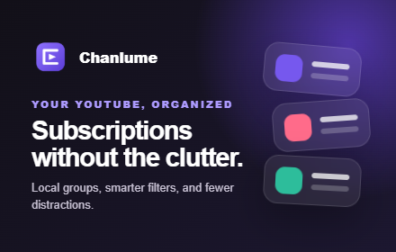
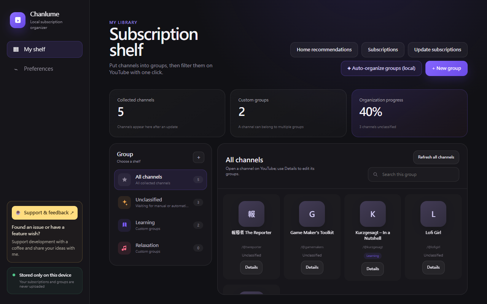
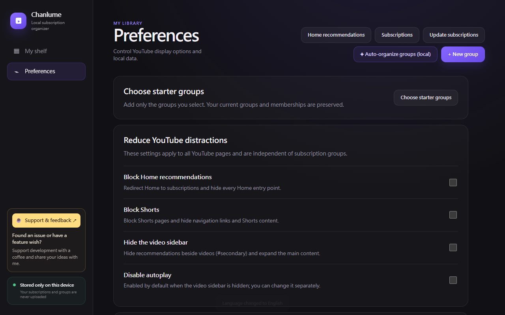

# Chanlume

> **Security notice (2026-10-21): Version 1.24.0 was withdrawn after a Microsoft Defender malware alert.** Version 1.24.1 was rebuilt with the scanned, byte-identical 1.23.3 production background script; local Defender rescans found no new detections. This is not a guarantee against future browser reputation flags or independent malware findings. Do not override antivirus warnings. The affected v1.24.0 tag remains only for forensic reference. See [security review](SECURITY_REVIEW_1.24.1.md).

> **1.24.2 update:** The optional proximity-open behavior of YouTube's left guide can now be disabled under **Chanlume → Reduce distractions → Auto-expand sidebar on hover**. Existing installations default to on; switching off disables only mouse-edge automatic opening, not the manual YouTube hamburger button. The preference stays local and persists across refreshes.

> **2026-10-21 sidebar refinement (main):** Collections, Subscriptions, Distraction settings and Chanlume settings now use a single 46px row rhythm and the same SVG chevron. The Chanlume settings trigger remains at the bottom of the expanded YouTube guide; opening it shows settings above the trigger while the independent main navigation scrolls in the remaining space. On a desktop with a fine mouse pointer, hovering within the left mini-guide edge briefly opens YouTube's native guide; moving into the page closes only the drawer opened by hover. A manually opened guide is never auto-closed. These changes are frontend-only and keep the native guide button, keyboard access, and saved library untouched.

> **2026-10-21 UI follow-up (source on main):** The left guide has consistent disclosure row sizing and no extra group-create + button. The Subscriptions category rail also has no create button; group creation remains in Collections and channel classification. Watch view/date metadata now has its own compact row below the original owner/actions controls, and transcript search controls are hidden without hiding native captions. The subscription View selector uses a styled, keyboard-accessible disclosure rather than the browser's native popup. This supersedes the earlier note below describing + buttons in the rail/sidebar; that earlier passage documents the previous implementation, not today's UI. No user library migration or additional permissions are involved.

<p align="center">
  
</p>

<p align="center">
  <strong>Your YouTube subscriptions, organized your way.</strong><br>
  Organize YouTube subscriptions into groups, follow favorites, and hide distractions. Your library stays in your browser.
</p>

<p align="center">
  No account · No server · No telemetry · No cloud AI
</p>

> 繁體中文簡介：Chanlume 是一個把 YouTube 訂閱變成「自己的書架」的 Chrome / Edge 擴充套件。你可以建立群組、直接在 YouTube 裡分類頻道、隱藏干擾內容，並使用完全在本機運作的自動分類。

## Overview



**Current GitHub version: 1.24.2.** Chanlume uses YouTube's loaded Subscriptions feed as the sole source for its Feed and Timeline views and channel video previews. As you scroll, YouTube loads older cards and Chanlume updates its filters and presentation without querying each channel separately. The Channels directory retains your full locally synchronized subscription list regardless of how many videos are loaded. Your groups, favorites and settings remain local.

The installed 1.23.3 version passed signed-in Helium testing on 2026-10-20, including a direct Timeline reload, multiple native infinite-scroll continuations, unique video IDs, full Channels directory and return to native Feed. It preserves YouTube's original subscription data flow and does not change the Home recommendation algorithm. See [technical validation](HANDOFF.md) for the exact checks and their limits.

**Unreleased local work after 1.23.3:** Watch-page Figma phase 01 arranges YouTube's native accessible view-count and publication-time labels beside the existing channel/actions row, with a quiet description border. It retains the original player, channel subscription and reaction controls, and restores YouTube's native presentation on unsupported data, route changes or when Chanlume is disabled. A late-mounted left-guide startup-mask bug was fixed in source. A local developer watcher was also added to automatically reload the unpacked extension on source changes. **None of these changes are part of the v1.23.3 ZIP/tag**. On 2026-10-21, the local Helium auto-reload and Watch/Subscriptions left-guide checks passed on the existing installation; the Watch Figma phase 01 layout still needs separate author acceptance.

**Further unreleased Figma-inspired Home/Watch work (2026-10-21):** Home groups the first three existing YouTube recommendation cards beneath a dismissible “Featured for you / 為你推薦” heading and refines native thumbnail/chip shapes; no recommendations are fetched, re-ranked or claimed to be previously missed. Watch can also reuse YouTube's visible native view/date strings when accessibility labels are blank, and adds a native-action-backed Suggestions / Transcripts / Live Chat selector above the existing related videos. Transcript and chat are available only when YouTube supplies their own controls; no video player, subscription action, comment data, group or stored preference is replaced. The UI was inspected on actual Helium Home/Watch tabs; **84/84 Node tests and 16/16 isolated browser suites passed**, including the new Home/Watch cases. A subsequent live transcript-panel ambiguity was fixed and tested again on Helium and in the focused Watch suite. The local watcher now compares file signatures so harmless filesystem notifications do not repeatedly reload the browser. Figma's fresh design-context API was quota-limited; these changes use the previously saved reference screenshots rather than claiming a pixel-perfect Figma export. Author visual approval is still pending.

**Watch follow-up:** The transcript tab retains YouTube's native text and timestamp seeking but hides recognized transcript-search UI only while Chanlume is active. The chat tab is omitted altogether when YouTube does not expose an enabled native chat control, leaving a two-column Recommendations/Transcripts switcher; when it does, the three-column layout remains. Both changes have browser-fixture coverage including an absent/reappearing chat control, seeking, SPA cleanup and power-off restoration. This follow-up's exact native-search selector still needs renewed Helium visual acceptance; only the earlier Home/Watch features above were checked live.

**Further unreleased Watch refinement:** YouTube's own transcript action is used for both creator-provided and automatically generated captions whenever YouTube makes a transcript available. When no actionable transcript exists, Chanlume omits the Transcript tab (and restores it if native captions become available later). The tab order remains Recommendations → Transcripts → Live Chat as native controls appear or disappear. In ordinary desktop layout, expanded native chat tracks the displayed player height after allowing for the tab strip; responsive/stacked, theater and fullscreen layouts retain YouTube's sizing. This is local interface logic only: no caption download, transcription service, new storage or permission. The focused browser fixture verifies auto-caption labels, delayed transcript availability, absent captions, live-chat resizing, theater/compact behavior and power-off cleanup. Actual Helium-specific visual acceptance of these refinements is still pending.

**Unreleased live Watch-page corrections (2026-10-21):** The specific linked YouTube Watch page was inspected through its existing signed-in browser tab. The Transcript and Chat selections now close the other native panel, Recommendations restores the native related list, and the timestamped native transcript remains visible while only its search box is hidden. In the inspected desktop viewport, both the native chat and transcript containers ended at the video's bottom edge. The current source passed **84/84 Node tests** and **16/16 local browser smoke suites**. The local development reload path also now reads its marker through the extension worker to avoid a browser-specific cross-origin console error. These repairs are not included in the existing 1.23.3 release; final author visual approval is still pending.

## Download & install

**[Download Chanlume 1.24.2](https://github.com/TANANIS/Chanlume/raw/refs/tags/v1.24.2/outputs/Chanlume-1.24.2.zip)** · [Source tag v1.24.2](https://github.com/TANANIS/Chanlume/tree/v1.24.2) · [Previous audited source tag v1.24.1](https://github.com/TANANIS/Chanlume/tree/v1.24.1)

The previous **1.24.0** download was withdrawn following a Defender alert. Do not install 1.24.0 from its historical source tag. [1.24.1 security review](SECURITY_REVIEW_1.24.1.md).

**Chrome Web Store status:** 1.24.2 is packaged for a future developer submission, but no Store upload, approval, or publication is claimed. If a downloaded copy is flagged, stop and report it instead of overriding protection.

Version 1.24.2 ZIP SHA-256: `51fe4fd050c3e12a179fe1ef2ca3c3d5395a30337528162b5cd82fe387e881c2`.

The annotated release tag **`v1.24.2`** fixes this version's source and package to commit [`7922ceb`](https://github.com/TANANIS/Chanlume/commit/7922ceb27027c1d28399914cd4a78e7b2ca4c617); the download link above uses that immutable version tag instead of the moving `main` branch. The Chrome Web Store remains a separate submission and review process.

### What's new in 1.24.2

- Added a sixth Reduce distractions switch, **Auto-expand sidebar on hover**, localized in Traditional Chinese and English.
- Existing users keep the previous hover-to-open behavior by default. Turning it off preserves manual YouTube guide control, with preference saved in the existing local state.
- Kept the production background identical to the audited historical 1.23.3 script; the new ZIP excludes all development-only reload hooks.

Version 1.24.1 ZIP SHA-256: `438155c9c0afa0da52f73ce74b376eeadc25ec7cb7173b3d4a77d7f041bcae77`.

### What's new in 1.24.1

- Reproducible production rebuild with the previously reviewed, byte-identical 1.23.3 background script.
- Checks that developer-only reload code stays out of the release archive.
- Defender custom scans of the new ZIP, background script and production files completed without additional detections. See the [security review](SECURITY_REVIEW_1.24.1.md). This does not guarantee acceptance by Helium's reputation system.

Version 1.24.0 ZIP SHA-256: `71212c6cef1756b95e02e6c1a6e6656a6daacabf6515e598f4e3f15ba4cca325`.

### What's new in 1.24.0

- Integrates subscribed-channel classification into YouTube channel and Watch headers, including adding a channel to a newly created group.
- Refines the native YouTube-backed Subscriptions Feed, Timeline and Channels views without inventing recommendations or losing historical group data.
- Reorganizes Watch metadata and the native Recommendations, Transcript and Chat controls. YouTube-supplied automatic captions work in its original transcript panel, with search hidden while Chanlume is active.
- Unifies the four left-sidebar disclosures, docks Chanlume settings at the bottom with upward expansion, and adds desktop mouse-edge reveal of the native YouTube sidebar.
- Keeps all developer reload scripts and marker files out of the production Store ZIP.

Version 1.23.3 ZIP SHA-256: `1686a281a984f3828e2ca353a2e59ed8683c10e0d7412ed51c79f26f31ef04f2`.

[Chrome Web Store listing](https://chromewebstore.google.com/detail/agnnbehkdkdkflknblhkmgciaekngole): the published item retains its previous name until this update is submitted, approved and published.

### What's new in 1.23.3

- Subscriptions now offers three views: native **Feed**, chronological **Timeline**, and the complete **Channels** directory. Their video content comes from YouTube's already-loaded subscription cards and native infinite scrolling.
- A collapsible, horizontally scrollable category rail filters the chosen view by your saved groups. The subscription tabs and category rail stay fixed while scrolling.
- A direct Timeline reload no longer prevents YouTube's initial native feed from mounting. Unavailable cards are described as *not yet loaded*, not as proof that a channel has no uploads.
- Chanlume's navigation and controls are integrated into YouTube's left guide; the former lower-right floating launcher and panel have been removed.
- Live Helium checks and 76 unit plus 14 browser regression suites passed. No subscription-library reset, server, telemetry or cloud AI was introduced.

### What's new in 1.19.4

- Groups and Follow controls now recognize YouTube's visible subscription state, including layouts that keep both Subscribe and Subscribed buttons mounted. Temporary save failures retry without losing the action.
- Favorites reads YouTube's new embedded JSON format as well as older channel pages. Normal uploads load while Shorts hiding is enabled, and request failures show useful retry information.
- The lower-right Chanlume button stays available across YouTube pages. Video fullscreen hides it and closes open panels; leaving fullscreen restores the button.
- The subscription toolbar uses a compact, sticky row with group colors, channel counts, horizontal scrolling and group search. Classification menus stay visible above YouTube containers.

### What's new in 1.19.3

- Renamed the interface, runtime messages, code globals, DOM/CSS namespaces, backup filenames and packaging to Chanlume.
- Existing local subscriptions, groups, favorites, settings and optional API keys migrate without resetting the library. Older JSON backups and saved group/Favorites links remain compatible.
- The package is available here on GitHub. The developer reported uploading it to Chrome Web Store on October 8, 2026; review and publication status have not been verified.

### What's new in 1.19.2

- Auto-organize now classifies all unfiled channels immediately, without a review or confirmation step. Each channel gets its best matching group; channels without enough information go into Other. Existing classifications are preserved and every assignment remains editable.
- A Favorites view on YouTube with a searchable picker, up to six newest public videos per channel, publication dates, refresh and per-channel retry. Favorites persist separately from groups.
- Dashboard cards open channels on YouTube, with a separate Details button; Manage members uses searchable checkbox rows; bulk edits stage and commit as one delta.
- Improved auto-grouping classification: handles script variants, strips contact noise, separates game development, science, stories, camping/survival and VTuber.
- Optional starter groups from onboarding and Preferences.
- A single global power button to pause or resume Chanlume on YouTube; groups and preferences are preserved.

The local automated checks pass: 72 unit/static/background/parser tests plus seven browser harnesses covering UI, favorites, classification, onboarding, performance, power toggles and YouTube regressions. Public Videos pages for all 11 channels in the reported failure case were successfully parsed. See [performance findings](PERFORMANCE.md) for the synthetic benchmark and its limits.


Historical 1.19.4 package SHA-256: `446118680dc3279d8e71814eab874d79ba7bec4263894c2030ef8ac98ed1d363`.

### Chrome

The currently published extension is available from the [Chrome Web Store](https://chromewebstore.google.com/detail/agnnbehkdkdkflknblhkmgciaekngole?utm_source=item-share-cb).

Manual installation of **1.24.0 remains suspended**. For the 1.24.2 package, which retains the audited 1.23.3 background script, use the steps below. Never override browser or antivirus warnings; if blocked, stop and report the detection.

1. Download the current 1.24.2 ZIP from the link above, without overriding any security warnings.
2. Extract the ZIP file.
3. Open `chrome://extensions/`.
4. Enable **Developer mode**.
5. Select **Load unpacked**.
6. Choose the extracted folder that contains `manifest.json`.
7. Reload any YouTube tabs that were already open.

### Edge

Use the same steps from `edge://extensions/`.

Developers can also clone this repository and load the `extension` directory directly.

### Local Helium development: automatic reload

For an existing unpacked Chanlume installation pointing to this repository's `extension/` directory:

1. Run `powershell -ExecutionPolicy Bypass -File .\scripts\dev-watch.ps1` from the repository root, and leave that terminal running. No server, browser debugger, additional extension permissions or dependencies beyond the existing Node.js runtime are required.
2. **Once, after adding this feature**, click **Reload** on the existing Chanlume entry at `helium://extensions` (or `chrome://extensions` if Helium redirects there), and reload the YouTube page. Do not remove and re-install the extension.
3. Subsequent edits under `extension/` automatically signal `chrome.runtime.reload()`. After reload, active YouTube pages and open Subscriptions/Channels pages are refreshed; inactive playing Watch tabs are left alone. Multiple fast file changes are debounced.
4. Press Ctrl+C in the watcher terminal to stop. If the watcher was started in a background/hidden process, run `powershell -ExecutionPolicy Bypass -File .\scripts\dev-watch.ps1 -Stop` instead; the stop command verifies the watcher PID belongs to this repository before terminating it. The `extension/dev-reload.json` marker is reset to disabled. The watcher does not modify your saved channel library or groups.

**Scope and status:** This is for local unpacked development only. The existing `v1.23.3` release ZIP/tag and `outputs/extension/` mirror remain unchanged. The browser-side mechanism requires the one-time initial extension reload because an already-running extension cannot execute newly added background code without one. The regular Playwright fixture suites do not prove live installed Helium activation.

**Live verification (2026-10-21):** After the one-time bootstrap, a controlled edit to a comment in `content/dev-reload.js` was detected by the watcher at 02:41:29 (Taipei); the open `/feed/subscriptions` document automatically reloaded at 02:41:30 without manual browser input. The complete local subscriptions directory (410 channels, 16 groups at inspection) and native feed remained visible. The original Watch page no longer retained `chanlume-early-enabled`; opening YouTube's native left-guide drawer displayed both original guide entries and Chanlume controls. By YouTube's default Watch layout the drawer is closed until the navigation button is clicked. Unit tests passed 85/85 and five targeted browser harnesses passed again. These are development-source checks, not a new release.

To update an existing unpacked installation, replace the files in its current folder, select **Reload** on the extension management page, then refresh YouTube tabs. Keeping the same loaded folder preserves the local library; exporting a JSON backup is also available.

## Why Chanlume?

YouTube recommendations and YouTube subscriptions serve different purposes.

Chanlume keeps those two experiences separate: your Home page can remain driven by YouTube's recommendation algorithm, while your Subscriptions page becomes a space you organize yourself.

Instead of replacing YouTube, Chanlume adds a lightweight organization layer directly into it.

## What you can do

### Organize subscriptions your way

- Create custom groups with your own names, colors, and icons.
- Put the same channel in multiple groups.
- Filter the Subscriptions Feed, Timeline and Channels views using the collapsible category rail; use the left YouTube guide for Chanlume navigation and settings.
- Browse older subscription videos via YouTube's native infinite scrolling, without creating a separate video-history database.
- See each stored channel's group directly beneath its video preview metadata in the Subscriptions feed.
- Classify a channel beside the Subscribe button on channel and watch pages.
- Pause or resume Chanlume's YouTube integration with the popup power button; your groups and preferences stay saved.
- Newly subscribed channels can enter **Unclassified** automatically; unsubscribed channels are removed from Chanlume automatically.
- Chanlume's YouTube-integrated controls follow YouTube's light and dark themes.

### Reduce recommendation-driven distractions

Chanlume lets you independently choose whether to:

- block the YouTube Home page and redirect to Subscriptions;
- hide Shorts and its navigation entry;
- hide the recommendation sidebar on watch pages;
- disable autoplay;
- hide already-watched videos from your subscription feed.

These controls are separate from subscription groups, so you can keep as much or as little of the original YouTube experience as you want.

### Auto-organize locally

Chanlume can classify unfiled channels in one click without sending your subscription library to a cloud AI service.

Suggestions can use:

- channel names and public descriptions;
- channel keywords;
- recurring topics from recent video titles;
- a built-in multilingual topic dictionary;
- optional public YouTube topic/category metadata;
- vocabulary learned from your own manual corrections.

Auto-organize uses the strongest available result, including low-confidence matches. Channels without a usable result go into **Other**. Changes are saved immediately; you can adjust them afterward with the ordinary group editing controls. Existing classifications are never overwritten automatically.

### Private by default

Chanlume stores your groups, channels, preferences, and learned classifications in `chrome.storage.local`.

There is:

- no Chanlume account;
- no Chanlume server;
- no telemetry or analytics;
- no advertising profile;
- no cloud AI classification.

If you optionally add your own YouTube Data API key, Chanlume sends public channel/video IDs directly to Google's YouTube Data API to retrieve public metadata. The key stays on your device and is excluded from JSON backups.

See [PRIVACY.md](PRIVACY.md) for the full privacy policy.

## Screenshots

### Subscription shelf


### Preferences



## Getting started

1. Open [YouTube's subscribed channels page](https://www.youtube.com/feed/channels).
2. Open Chanlume from the browser toolbar and choose **Update subscriptions**.
3. Chanlume will load your subscribed channels and save the collected public channel information locally.
4. Open **Manage groups**.
5. Create groups manually, or select **Auto-organize groups (local)** to classify all unfiled channels immediately.
6. Adjust any assignments afterward with **Details** or **Manage members**.
7. Return to YouTube and switch shelves directly from the YouTube interface.

You can also classify the channel you are currently watching from the **Groups** control beside its Subscribe button.

## How local classification works

Chanlume's classifier ranks local signals to choose a destination for each unfiled channel.

It scores signals such as channel descriptions, keywords, recent video titles, known topic phrases, exclusions, official YouTube categories, and vocabulary learned from manual group assignments.

The highest-scoring usable result becomes the channel's initial group. Confidence still helps describe the result internally, but does not require a user decision. Channels without enough usable signals go into Other.

There is no initial classification review or confirmation step. The progress dialog closes after saving, and the updated groups appear immediately. Existing group editing supports corrections and multiple group memberships. A failed save offers retry, and cancellation during analysis prevents the classification commit.

## Optional: YouTube Data API

Chanlume works without an API key.

If you want additional public classification signals, you can enable **YouTube Data API v3** in your own Google Cloud project and paste your API key into Chanlume Preferences.

When enabled, Chanlume can use public YouTube channel topics, video categories, and related metadata alongside the local classifier.

Your API key:

- is stored locally;
- is not included in Chanlume JSON exports;
- is sent only to Google's YouTube Data API when that feature is used.

## Backup and transfer

Chanlume can export and import your local library as JSON.

Exports include your groups and channel URLs. Sensitive values such as your YouTube Data API key are not included.

You can also clear Chanlume's local data without changing your actual YouTube subscriptions.

## Languages

Chanlume currently supports:

- English
- 繁體中文

The default interface is English unless a Traditional Chinese browser locale is detected. Changing the UI language does not rename your channels or custom groups.

## Technical notes

- Chrome Extension Manifest V3
- Vanilla JavaScript, HTML, and CSS
- Local state stored with `chrome.storage.local`
- Incremental YouTube DOM observation instead of repeatedly rescanning the entire page
- Background tabs pause DOM observation to reduce unnecessary work
- Supports multiple generations of YouTube video/channel renderers
- JSON backup and restore
- Node.js unit tests plus Playwright UI smoke tests

## Development and verification

Versioned packaging: stop the development watcher, then run `scripts/package-extension.ps1` on Windows (or `scripts/package-extension.py` with Python). The scripts produce `outputs/Chanlume-<version>.zip`, build a production-only `outputs/extension/` mirror and verify the mirror/ZIP entries byte-for-byte. The development reload marker, polling script and background reload handlers are excluded from production. Existing version archives are never overwritten.

When Edge is unavailable, set `CHANLUME_BROWSER` to an existing Playwright Chromium executable before using `tests/local-fixture-preload.cjs`. This runs synthetic fixtures in an isolated temporary browser profile.

Core checks can be run with Node.js:

```powershell
node --test tests/shared.test.js tests/manifest.test.js tests/background.test.js tests/youtube-regressions.test.js
node --check extension/shared.js
node --check extension/content/content.js
node --check extension/popup/popup.js
node --check extension/dashboard/dashboard.js
```

The repository also includes UI smoke tests for the dashboard, onboarding flow, popup, group management, localization, and YouTube-integrated controls. Set `CHANLUME_NODE_MODULES` to the directory containing Playwright, serve the repository on `http://127.0.0.1:18766`, then run the `tests/*-smoke.cjs` scripts.

If the host blocks loopback HTTP, the offline fixture transport serves the same local files through Playwright routing:

```powershell
node --require ./tests/local-fixture-preload.cjs tests/ui-smoke.cjs
node --require ./tests/local-fixture-preload.cjs tests/youtube-regressions-smoke.cjs
```

Build and verify the unpacked mirror and ZIP with `python scripts/package.py`.

## Current limitations

YouTube is a continuously changing single-page application. Chanlume depends on public page structure and public metadata, so future YouTube UI changes may occasionally require selector or parser updates.

Subscription discovery may automatically scroll YouTube's subscribed-channels page until the list stabilizes. Classification quality also depends on the public metadata available for each channel; channels without usable signals are placed in Other, and any assignment can be corrected manually.

## Project principles

Chanlume currently focuses on three principles:

1. **User control over recommendation-driven behavior.**
2. **Local-first organization and privacy.**
3. **Automation that stays inspectable and reversible.**

## License

Chanlume is released under the [MIT License](LICENSE).

## Disclaimer

Chanlume is an independent project and is not affiliated with, endorsed by, or sponsored by YouTube, Google, or PocketTube.

The original feature concept was inspired by subscription-management tools such as PocketTube, while Chanlume's implementation, interface, local classifier, and product direction are independently developed.
`n## 2026-10-21 classification and Home reconciliation`nThe experimental Home Featured for you grouping was removed because it merely rewrapped YouTube recommendations and had no evidence for a missed-video claim. Native Home card ordering and continuation remain untouched. The Watch and channel-header classification controls retain YouTube Subscribe; unsubscribed channels can discover the disabled classification menu but cannot mutate library membership. Subscribed channels can select existing groups or create a group and file the channel atomically. A visible add-group entry is present in the subscriptions category rail and next to the sidebar collections heading, using the existing collection editor. All 16 browser smoke suites passed after waiting for asynchronous fixed-tab alignment in the Figma fixture; targeted unit tests passed 80/80 (additional dev tests are separate). No production store package or released v1.23.3 tag was rewritten.`n
